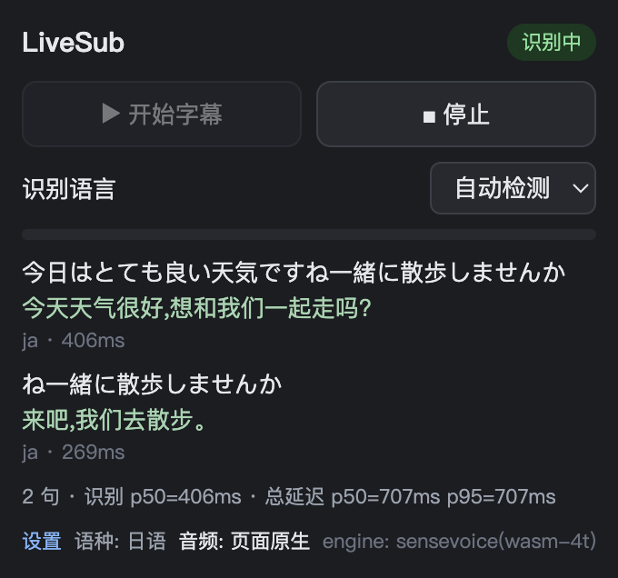
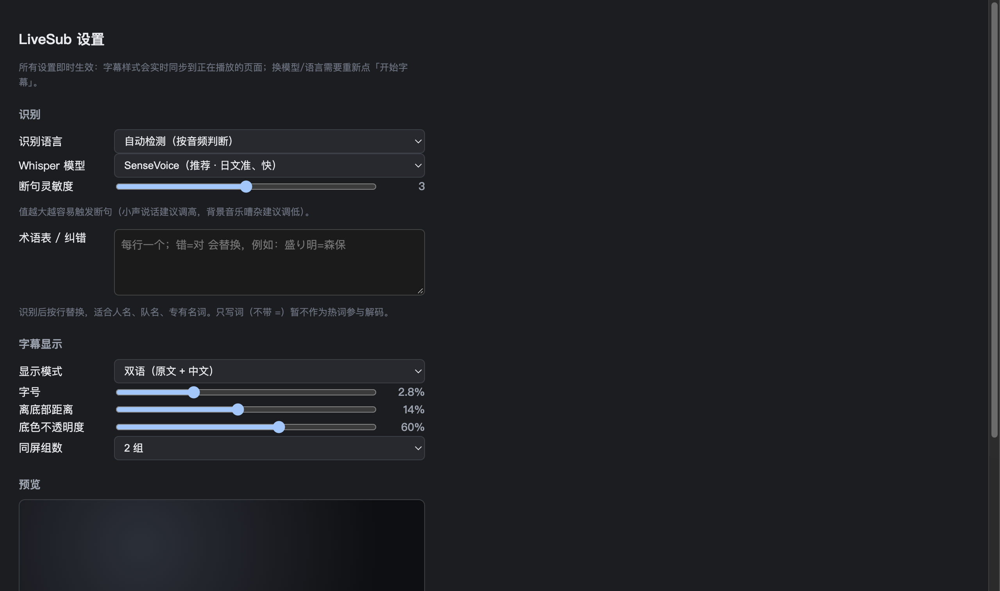

# LiveSub — 实时双语字幕 Chrome 扩展

抓取当前标签页的视频声音 → 本地 SenseVoice/Whisper 识别 → 本地 opus-mt 翻译 → 双语字幕覆盖在视频上。
**全本地推理，零 API 费用，运行时不访问外网。**

> 源码：<https://github.com/porridgec/livesub> · 反馈：<https://github.com/porridgec/livesub/issues>


<sub>截图视频：Big Buck Bunny（© Blender Foundation，CC BY 3.0）；截图为项目自测环境，已裁掉网页侧边内容。</sub>

| popup | 设置 |
|---|---|
|  |  |

## 功能

- **默认直接采集 `<video>` 元素自己的音轨**（`video.captureStream()`，在内容脚本里做 VAD）：
  页面声音完全不受影响，**音画天然同步**，也不需要点图标授权（popup 显示「音频: 页面原生」）
  - 站点不支持时（DRM / 跨域媒体 / 没有 video）自动回退到 `tabCapture` + 扩展回放：
    页面会被静音，扩展把音频接回扬声器（popup 显示「音频: 扩展回放」，可能有约 100ms 音画延迟）
  - 页面本来就被用户静音 → 不替它出声（「页面已静音」）
- **Silero VAD** 自动断句（音乐/噪声下比能量 VAD 稳，静音判定可到 ~0.3s），
  **SenseVoice（推荐，准且快）或 Whisper** 逐句识别；`自动检测` 语种
- **边说边出双语临时字幕**：SenseVoice 每 ~0.8s 对当前这段音频出一次临时文本（原文 + 中文，淡色显示），
  说完后由正式句子替换；长句不用等到整段结束才看到字
- **两行滚动窗口**：参考 YouTube，临时字幕占一个槽位，正式行最多 `maxLines-1` 条；partial 的稳定前缀正常显示，
  尾部淡色，减少整行跳动
- **术语表 / 纠错**：设置里每行 `错=对`，识别后、翻译前替换（人名、队名、专有名词）
- 原文先上屏，中文译文随后补齐：
  - 英语 → `opus-mt-en-zh` 直译
  - 日语 → `opus-mt-ja-en` → `opus-mt-en-zh` 两段（没有现成的 opus-mt ja→zh；NLLB-600M 太重、实时不可用）
- 字幕覆盖层：
  - 自动锚定页面里「可见面积最大 + 正在播放」的 `<video>`，滚动/缩放/换清晰度重建都能跟上
  - Shadow DOM 隔离样式 + Popover API 进入 top layer，**全屏视频也能压住**
  - 支持 iframe 内的视频（`all_frames`）
  - 字号 / 离底部距离 / 底色透明度 / 同屏组数 / 双语·原文·中文 都可调，改动实时生效
- popup：开始/停止、语种快选、实时电平、最近原文+译文、p50/p95 延迟
- 快捷键 `Ctrl+Shift+L`（macOS 上对应 `⌘⇧L`，如果没生效到 `chrome://extensions/shortcuts` 手动设置）
- tab 刷新/关闭自动收尾，引擎报错会在 popup 里显示

## 架构（Manifest V3）

```
popup / 快捷键
  └→ Service Worker（只做编排：选采集方式、offscreen 生命周期、消息路由、注入内容脚本）

首选：Content Script 抓 <video>.captureStream() 的音轨（页面声音不受影响）
  → AudioWorklet 48k→16k → 能量 VAD 断句 → base64 片段
  → Offscreen：SenseVoice(ONNX/CTC) 或 Whisper(WASM/q8) → 原文事件 → opus-mt 翻译链 → 译文事件

回退（DRM/跨域媒体/没有 video）：tabCapture
  → Offscreen getUserMedia(tab) → AudioContext
      ├→ destination（tabCapture 会静音页面，这里回放）
      └→ AudioWorklet 48k→16k → VAD → SenseVoice/Whisper → 翻译

字幕：SW 转发 chrome.tabs.sendMessage → Content Script
  → Shadow DOM 覆盖层，rAF 跟随 video rect，fullscreenchange 时把 Popover 重新抬到 top layer
```

关键决策：

- **元素采集优先**：`tabCapture` 会静音页面、回放又有 100ms 级延迟；直接抓 `<video>` 的音轨既不静音也没有音画延迟，
  还顺带绕过了 activeTab 授权限制。只有元素采集不可用时才回退 tabCapture
- **推理放 offscreen**：MV3 Service Worker 随时会被杀，且没有 WebGPU/Web Audio 渲染图；
  元素模式把 VAD 放在内容脚本（音频在页面里），ASR/翻译仍在 offscreen
- **VAD + 逐句转写**：Whisper/SenseVoice 都是非流式模型，只能靠断句做「近实时」
- **主用 SenseVoice**：非自回归 CTC，日文 CER ~15%（Whisper base ~39%），5s 音频约 0.4s；
  前端（Kaldi fbank + LFR + CMVN + CTC）用 JS 实现，直接跑在 ort-web 上；Whisper 作为后备
- **Silero VAD**：512 sample/32ms 一窗，阈值随灵敏度调整；音乐/掌声下比能量 VAD 稳，把静音判定从 0.6s 压到 ~0.3s
- **双语 partial 字幕**：VAD 还在说话时每 0.8s 对最近 4.5s 音频做一次 SenseVoice + 翻译，先展示原文+中文；
  正式句子一出来就作废旧 partial，避免字幕倒退/闪烁
- **语种检测**：SenseVoice 用语言 query token 自带检测；Whisper 则用 encoder + 一步 decoder 读 `<|lang|>` logits
- **翻译走小模型链**：ja→en→zh 两个 ~100MB 模型，WASM 下单句 100~300ms；NLLB-600M（870MB）已从默认打包中移除

## 快速开始

```bash
npm install
npm run fetch-models      # 下载 SenseVoice + Whisper + 翻译模型，约 600MB
                          # （Whisper/翻译模型可用 HF_ENDPOINT=https://hf-mirror.com 走镜像）
npm run build             # 产出 dist/（约 640MB，模型直接打包进扩展）
```

Chrome → `chrome://extensions` → 打开开发者模式 → 「加载已解压的扩展程序」→ 选 `dist/`。

**使用**：打开要看的视频页面（保持它在前台）→ 点扩展图标 →「开始字幕」。
首次会加载模型（SenseVoice 约 5–15 秒，之后常驻缓存）。字幕出现在视频画面上，原文 + 中文各一行。

> 首选元素采集只需要页面里有 `<video>`，不需要额外的 activeTab 授权；
> 只有回退到 tabCapture 时，才要求你在这个视频页上点扩展图标。
> 开始后刷新页面会断流，需要重新点一次开始。

## 模型

| 用途 | 模型 | 大小 | 备注 |
|---|---|---|---|
| 语音识别（默认） | **SenseVoiceSmall int8**（sherpa-onnx 2024-07-17） | ~228MB | ja/en/zh/ko/yue；CTC 非自回归；5s 约 0.35–0.5s；日文 CER ~15% |
| 语音识别（后备） | `Xenova/whisper-base` | ~79MB | SenseVoice 加载失败时自动回退；5s 约 1.1s |
| 语音识别（最轻） | `Xenova/whisper-tiny` | ~44MB | 5s 约 0.5s，日文易错 |
| 语音端点（VAD） | Silero VAD（onnx-community） | ~2.1MB | 默认；失败自动回退能量 VAD |
| 英→中 | `Xenova/opus-mt-en-zh` | ~116MB | 直译 |
| 日→英 | `Xenova/opus-mt-ja-en` | ~111MB | 与 en-zh 串联完成日→中 |

`npm run fetch-models sensevoice` / `whisper-tiny` / `whisper-base` 可以只补某个模型。
`models/` 在构建时按目录拷贝进 `dist/`，不用的模型不会被打包（`models/Xenova` 下的基准模型不会被拷贝）。

## 延迟参考（Apple Silicon，WASM 单线程，5 秒语音）

| 阶段 | 耗时 |
|---|---|
| 模型首次加载（SenseVoice + 翻译链预热） | ~10–20s（之后常驻） |
| VAD 断句等待 | Silero ~0.3s 静音（能量 VAD 后备 0.6s；最长 5s 强制切句） |
| **SenseVoice（WASM 4 线程）** | **~0.2–0.4s / 5s 音频** |
| Whisper base / tiny（WASM 4 线程） | ~1.1s / ~0.5s |
| 翻译（预热后） | ~0.2–0.5s/句 |
| **说话开始 → 首条双语临时字幕** | **约 0.8–1.2s**（每 ~0.8s 刷新，原文+中文） |
| **话语结束 → 原文定稿** | **约 0.3–0.6s**（Silero 0.3s 静音判定 + ASR 0.2–0.4s） |
| **话语结束 → 译文上屏** | **p50 ~0.4s**（popup 实测，Silero + SenseVoice） |

## 设置

`chrome-extension://<id>/src/options/options.html`（popup 底部「设置」）：

- 识别语言：自动检测 / 日语 / 英语 / 中文（中文只显示原文）
- 识别模型：SenseVoice（推荐）/ Whisper base / Whisper tiny（换模型需要重新开始）
- 断句灵敏度 1–5
- 字幕样式：显示模式、字号、离底部距离、底色不透明度、同屏组数；带实时预览

## 开发与测试

```bash
npm run watch            # vite 增量构建
npm run make-test-media  # 用 macOS say 生成 test/media/*.m4a
npm run e2e              # 端到端测试（file 音源，验证识别/翻译/覆盖层）+ 截图
npm run e2e:en           # 端到端测试（英语）
npm run e2e:element      # 元素采集路径：内容脚本抓 <video> 音轨（页面声音原生）
npm run e2e:hotkey       # tabCapture 回退路径（macOS，需辅助功能权限）
node scripts/dev-e2e.mjs --url https://www.w3schools.com/html/html5_video.asp  # 在真实网页上验证覆盖层锚定/全屏
```

端到端测试用 Chrome for Testing 加载 `dist/`，起本地静态服务，打开 `test/index.html`，
验证：采集 → 音频能量 → 回放支路 → 识别原文 → 中文翻译 → 字幕覆盖层贴合视频 → 全屏 → 停止，
并把截图写到 `test/artifacts/`（`overlay-*.png` / `fullscreen-*.png` / `popup-*.png` / `options.png`）。

`file` 模式（默认）说明：CDP 合成点击拿不到 tabCapture 需要的 `activeTab` 授权，
所以测试让 offscreen 解码本地音频、按真实速度喂同一套 VAD→ASR→翻译管线。
元素采集路径用 `npm run e2e:element`：它不依赖 tabCapture，验证的是从 `<video>` 音轨到字幕的完整链路。
tabCapture 回退路径用 `npm run e2e:hotkey`（或手动点扩展图标）验证。

### 目录

```
manifest.json
src/background/sw.ts           # tabCapture / offscreen / 路由 / 注入 / tab 生命周期
src/offscreen/offscreen.ts     # 音频管线 + 模型就绪门控 + 双队列（ASR / 翻译）+ 状态
src/offscreen/asr.ts           # Whisper 管线、语种检测、文本清洗
src/offscreen/translate.ts     # opus-mt 翻译链（Promise 缓存）
src/offscreen/vad.ts           # 能量 VAD（Silero 不可用时的后备）
src/offscreen/vad-silero.ts    # Silero VAD（ONNX，默认）
src/offscreen/pcm-worklet.js   # 48k→16k 低通 + 线性插值
src/content/subtitle-overlay.ts# 字幕覆盖层（Shadow DOM + Popover + rAF 跟随）
src/popup/ src/options/        # 界面
test/                          # 本地测试页 + 生成的测试音频
scripts/dev-e2e.mjs            # 端到端测试
scripts/fetch-models.mjs       # 模型下载
```

## ASR 调研结论（详细报告见 [docs/asr-research.md](docs/asr-research.md)）

用 YouTube 日文访谈 `Qm8X7pbCngA` + 官方自动字幕做了同一参考下的横向评测：

| 方案 | 日文 CER（中位） | 速度 | 结论 |
|---|---|---|---|
| Whisper base | ~39% | RTF 0.057（CPU） | 专有名词/同音词错得多 |
| Whisper small | ~37% | RTF 0.13 | 提升有限、慢 2–3× |
| **SenseVoiceSmall int8（当前默认）** | **~15%** | **RTF 0.012** | 显著更准 + 快一个数量级，且无重复循环 |

已用纯 JS 实现 SenseVoice 的 fbank/LFR/CMVN/CTC 前端，并在 `onnxruntime-node` 上验证输出与
sherpa-onnx 官方 CLI 基本一致（`scripts/sensevoice-frontend.mjs`），因此可以继续用现有 ort-web 集成，
不需要引入新的 WASM 运行时，**已接入并设为默认**：浏览器实测 **355–490ms / 5s 音频**，
端到端（话语结束 → 译文上屏）约 **0.8s**；SenseVoice 加载失败会自动回退 Whisper。

另外已启用的优化：manifest 里加了 COOP/COEP，扩展页 `crossOriginIsolated=true`，
ort-web 用 4 个 WASM 线程，Whisper base 在浏览器里从 ~2.9s 降到 ~1.1s。

## 字幕系统架构

学习 YouTube 两行滚动 / 词级时间、B 站 CTC + 动态解码器 + 热词的思路，LiveSub 把
「ASR 结果」与「字幕窗口」解耦，并加入 token 时间戳、稳定 partial、术语表。
设计说明见 [docs/subtitle-architecture.md](docs/subtitle-architecture.md)。

## 平台字幕调研

YouTube / Bilibili 自带字幕（人工 CC、YouTube Gemini 自动字幕、B站 AI 字幕）的接口、格式、
实测可用性与「平台优先 + 本地 ASR 兜底」的落地方案，见
[docs/platform-subtitles.md](docs/platform-subtitles.md)。

## 安全与隐私

- **全本地、零上传**：音频只在扩展进程内处理，不写盘、不上传；运行时不会向外部服务器发请求
  （SenseVoice / Whisper / 翻译 / VAD 模型都随扩展本地加载）。
- **无遥测、无分析、无远程日志**；设置只保存在 `chrome.storage.sync`。
- **页面无法调用扩展**：没有声明 `externally_connectable`，也没有 `web_accessible_resources`。
- **CSP**：`script-src 'self' 'wasm-unsafe-eval'; object-src 'self'`；没有 `unsafe-eval` / `unsafe-inline`。
- **模型供应链**：`npm run fetch-models` 固定 Hugging Face revision；SenseVoice / Silero VAD 下载后校验 SHA-256。
- **测试钩子**：`start-test` 只接受 `127.0.0.1` / `localhost` 音源或扩展内路径，且只能由扩展自身上下文触发。
- **依赖审计**：`npm audit` 0 漏洞（`sharp` 通过 override 固定到 0.35.5；它是 Node 开发侧传递依赖，
  不会进入扩展 bundle）。
- **音频回退路径**：元素采集不可用时回退 `tabCapture`，页面会被静音、由扩展回放；这是 Chrome API 行为，
  不是数据外传。

### 权限说明

| 权限 | 用途 |
|---|---|
| `tabCapture` | 元素采集不可用时抓取标签页音频（回退路径） |
| `offscreen` | 在 SW 之外运行音频图和 ONNX 推理 |
| `storage` | 保存设置与短生命周期的采集状态 |
| `scripting` | 向已打开的页面动态注入字幕覆盖层 |
| `activeTab` | Chrome 对 `tabCapture` 的要求 |
| `<all_urls>` | 在任意视频站点查找并覆盖 `<video>` |

完整审计报告见 [docs/security-audit.md](docs/security-audit.md)；安全问题请通过 [SECURITY.md](SECURITY.md)
的私有渠道报告。

## 已知限制 / 排障

| 现象 | 原因 / 处理 |
|---|---|
| 点开始报 `Extension has not been invoked for the current page` | 当前标签页不是视频页，或扩展不是在这个 tab 上被点击的：切到视频页再点图标 |
| 开字幕后页面没声音 | 看 popup 底部的「音频: …」：`页面原生`=元素采集，声音由页面自己播；`扩展回放`=回退 tabCapture；`页面已静音`=tab 本来就是静音状态。都不对就看扩展错误页 |
| 音画不同步 | popup 显示「扩展回放」时是 tabCapture 的固有延迟；显示「页面原生」时不应该有不同步 |
| `模型加载失败` | 没执行 `npm run fetch-models`；SenseVoice 失败会自动回退 Whisper，若 Whisper 也没下载则报错 |
| 识别出的语种不对 | 自动检测依靠前 2 秒语音；手动在 popup/设置里选语种 |
| 字幕条数/位置不合适 | 设置里调「同屏组数 / 离底部距离 / 字号」 |
| 听到音乐/掌声也出字 | 当前用 Silero VAD；可在设置里调低断句灵敏度 |
| 页面刷新后字幕停了 | tabCapture 流随页面刷新结束，重新点「开始字幕」 |
| 字幕没出现但 popup 有识别 | 页面里没有可见 `<video>`（纯音频页/画中画），或站点把视频放在跨域 iframe 里未被注入 |
| popup 显示「扩展回放」 | 该站点无法元素采集（DRM / 跨域媒体 / captureStream 被限制），回退到了 tabCapture，音画可能有约 100ms 延迟 |
| WebGPU 相关 | 当前版本固定 WASM。q8 权重在 WebGPU 上会乱码，base 的 fp16 在 WebGPU 上推理卡死，等 onnxruntime-web WebGPU EP 稳定后再开放 |
| 韩语 | 暂未提供翻译模型（只显示原文） |
| 日文识别质量 | 默认 SenseVoice 已明显好于 Whisper（CER ~15% vs ~39%）；ASR 错字仍会被翻译放大，可切 Whisper 对比 |

## 变更记录

- **0.4.0**：字幕系统架构调整——CTC token 时间戳、CaptionWindow 两行滚动/稳定 partial、术语表后处理；
  设计说明见 `docs/subtitle-architecture.md`。
- **0.3.1**：Silero VAD（静音判定 0.29s）+ 双语临时字幕（partial 也翻译）；ORT 调用串行化。
- **0.3.0**：默认 ASR 换成 SenseVoiceSmall；边说边出临时字幕（0.8s 一次）；
  VAD 保持 0.6s/5s（实测更短的 0.45s/4s 会把句子切断、翻译明显变差）（ONNX/CTC + JS fbank 前端），Whisper 后备；COOP/COEP + 4 线程；
  元素采集（页面原生音轨）成为默认采集路径；端到端测试覆盖两种采集/识别引擎。
- **0.2.0**：实现字幕覆盖层（全屏 / iframe / 样式）、真人快捷键与动态注入、
  tab 音频回放、语种自动检测、base 默认、ja→en→zh 翻译链、模型就绪门控、
  端到端测试与截图、README。
- 0.1.0：M0–M2 骨架（tabCapture、offscreen、VAD、Whisper、popup 状态）。

## 许可证

代码采用 **MIT**（见 [LICENSE](LICENSE)）。模型权重不随仓库分发，由 `npm run fetch-models` 从上游下载；
各模型/依赖的许可证与署名见 [NOTICE.md](NOTICE.md)。
